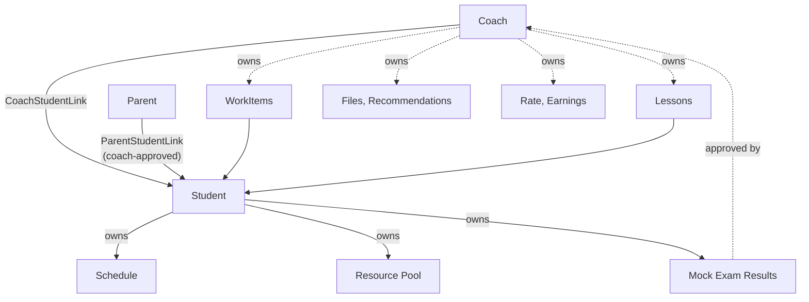

# Domain Model

Business concepts from catalog §36 and [[Source - Requirements v2 (TR)|v2]], resolved into a design.
This is the *domain*, not the schema — tables live in [[Data Model]].

## The shape of the thing

Everything hangs off two relationships. Not off the user, not off the student — off the **link**.

Read that diagram as the authorization model too: if a piece of data is not reachable from the
caller through an **active link**, they cannot see it ([[BR-024]]).

## Aggregates

### Identity

| Concept | Notes |
| --- | --- |
| `User` | credentials, contact, role |
| `Coach` / `Student` / `Parent` | role profiles; `Student` holds `gradeLevel` and exam track ([[FR-03]]) |

One role per user in v1 ([[Open Questions|Q-08]]).

### Relationships

| Concept | Notes |
| --- | --- |
| `CoachStudentLink` | the unit of access. Has a lifecycle and an end date, never deleted ([[FR-04]]) |
| `InviteCode` | single-use, expiring, produces a link on acceptance |
| `ParentStudentLink` | requires coach approval; max 2 active ([[BR-003]], [[BR-004]]) |
| `VisibilitySettings` | the three switches the coach opened to parents: progress / exams / finance ([[FR-20]], K-29) |

### Work

| Concept | Notes |
| --- | --- |
| `WorkItem` | task or assignment, discriminated by `type` ([[ADR-0005]]); carries `requiresApproval` and the frozen `lateCutoff` ([[BR-027]]) |
| `WorkItemSubmission` | one per student "done"; a returned item gets another |
| `WorkItemEvent` | the append-only history that derives status ([[FR-21]]); bulk approvals write one event per item |
| `Plan` | coach-owned reusable tree: unit → topic → task, each task with day offset and duration ([[FR-23]]) |
| `PlanAssignment` | plan × student × start date, with per-student removed tasks; assigned tasks are **copies** |

**Status is derived, not stored as truth.** `OVERDUE` is a function of `dueAt`, `lateCutoff` and
now; on-time/late is a function of `submittedAt` against `dueAt + lateCutoff` ([[BR-009]],
[[BR-027]]). Deriving means the system can never be stale, and no cron job can forget to run.
Completion follows the dispute model ([[BR-006]]).

### Lessons

| Concept | Notes |
| --- | --- |
| `Lesson` | request → accepted → completed/cancelled ([[FR-09]]); typed: one-on-one / group / exam analysis |
| `LessonParticipant` | per student in a group lesson: own response, attendance and earning ([[BR-028]]) |
| `Attendance` | attended / no-show / cancelled ([[FR-10]]) — coach-marked, always on, finance-independent |
| `ScheduleEntry` | reserved for the v1.1 grid; v1 shows a read-only timeline projected from lessons + tasks ([[FR-11]]) |

### Study material

| Concept | Notes |
| --- | --- |
| `Resource` | a pool item belonging to a student |
| `ResourceRecommendation` | coach → student, retains which coach ([[FR-12]]) |
| `File` + `FileShare` | coach-owned, shared with selected students ([[FR-13]]) |
| `Subject` / `Topic` | shared vocabulary for resources and exam results |

Note the collision the Turkish hides: **"ders" means two things** — a coaching session (`Lesson`)
and a school subject (`Subject`). Keep them apart in code or the confusion is permanent.

### Exams

| Concept | Notes |
| --- | --- |
| `MockExamResult` | header: name, type, date, totals, status, `approverCoachId` ([[BR-031]]) |
| `MockExamSubjectResult` | per-subject correct/wrong; **net auto-calculated per exam type**, score manual ([[BR-018]], [[BR-019]]); variable subject set per type |
| `ReportCard` | student-entered per-term school grades, read-only to coach and parent ([[FR-24]]) |

### Money

The whole money area is the **opt-in finance module**, default off and truly deletable
([[BR-029]], [[FR-25]]).

| Concept | Notes |
| --- | --- |
| `CoachStudentRate` | effective-dated price per relationship, with `model` (per-lesson / monthly flat) and per-lesson-type amounts ([[FR-18]]) |
| `TimesheetEntry` | which lessons count as billable (per-lesson model) |
| `Earning` | the ledger's **debit**: amount + **frozen rate snapshot** ([[BR-023]]); source depends on the price model ([[BR-021]]) |
| `Payment` | the ledger's **credit**: a collection the coach enters manually ([[FR-25]]) |
| `Subscription` | coach ↔ platform, unrelated to the above ([[FR-22]]); v1 is a free beta with a student limit |

See [[Pricing and Earnings]] for why this is several concepts and not one.

### Platform

| Concept | Notes |
| --- | --- |
| `Notification` | one row per recipient per event, structured payload |
| `NotificationTemplate` | coach-owned reusable text, with a target-audience field: student / parent (K-34) |
| `ScheduledReminder` | fires at task time; deferred by the student's quiet hours ([[FR-16]]) |
| `AuditLog` | append-only, actor + timestamp ([[FR-21]]); never backfilled |

## Invariants

1. Access derives from an **active link**, never from a role alone. ([[BR-024]])
2. Every coach-created row carries `coachId`; management is filtered by it on every request, and
   lessons/files/notifications/money are invisible to other coaches (see/manage split, [[BR-024]]).
3. `submittedAt` and `approvedAt` are never interchanged. ([[BR-009]])
4. Snapshots freeze at creation: money rows carry their rate, work items their late cutoff.
   ([[BR-023]], [[BR-027]])
5. Nothing is hard-deleted — except the coach-initiated finance wipe. ([[BR-025]], [[BR-029]])
6. Statistics read only approved exam results — rule under review as [[Open Questions|Q-20]], the
   single-scope discipline stands regardless. ([[BR-017]])
7. Task and assignment progress are computed separately. ([[BR-005]])
8. Amounts never appear in logs, notification bodies, analytics events or search indexes (K-41).

## Related

[[Data Model]] · [[State Machines]] · [[Authorization Matrix]] · [[Pricing and Earnings]] · [[Progress and Filiz]]
