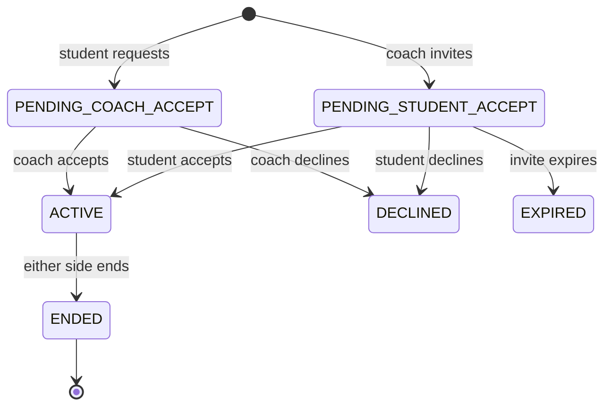
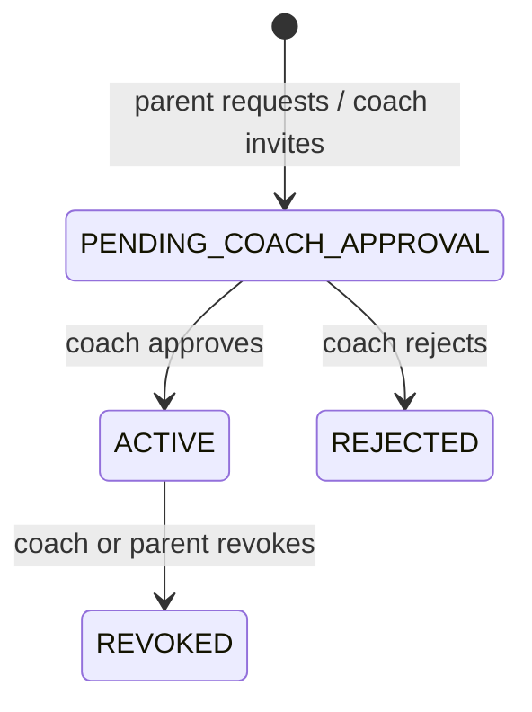
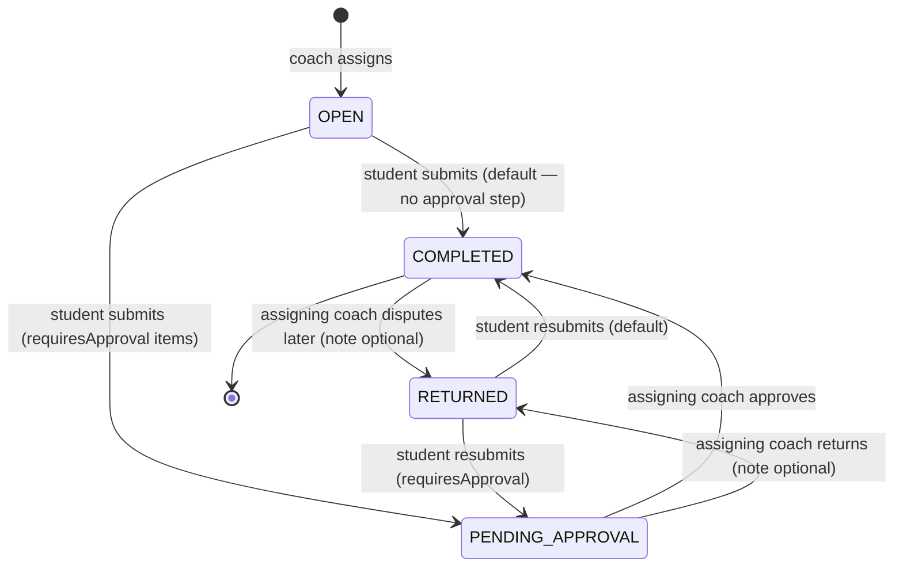
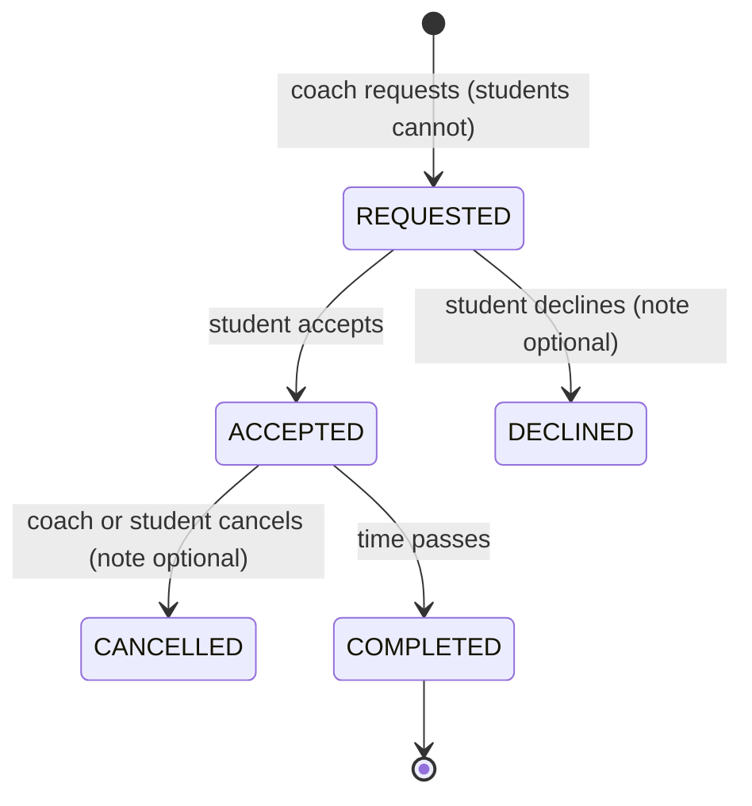
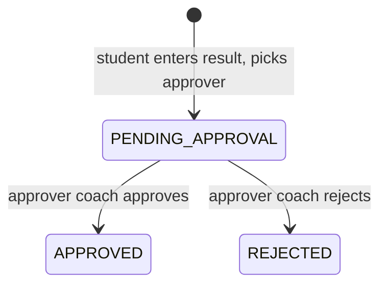
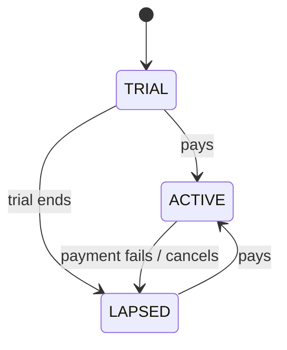

# State Machines

Every transition below is guarded by *who* may perform it. The actor is part of the machine, not an
afterthought.

## Coach–student link ([[FR-04]])

`ENDED` is terminal for that record; the pair may create a new link later. History survives
([[BR-002]], [[BR-025]]), and the coach's access becomes **read-only** — no new content, while the
student keeps that coach's shared files and recommendations ([[BR-030]]).

## Parent–student link ([[FR-05]])

At most two links may be `ACTIVE` per student ([[BR-004]]).

## Work item — task and assignment ([[FR-06]], [[FR-07]])

Since v2, completion follows the **dispute model** ([[BR-006]]): the machine has two paths, chosen
by the item's `requiresApproval` flag at creation.

`COMPLETED` splits into `COMPLETED_ON_TIME` / `COMPLETED_LATE` by comparing `submittedAt` against
`dueAt + lateCutoff` — the cutoff frozen onto the item at creation ([[BR-027]]).

**`OVERDUE` is not a state in this diagram on purpose.** It is a *view* of `OPEN` or `RETURNED` once
`now > dueAt + lateCutoff`. Deriving it avoids a scheduled job and can never be stale.

Guards:

| Transition | Who |
| --- | --- |
| assign | the coach, with an active link |
| submit / resubmit | the student the item belongs to |
| approve / return / dispute | **only the assigning coach** ([[BR-007]]); bulk approve audits per item ([[FR-06|FR-06.14]]) |

The on-time/late branch uses `submittedAt`, never `approvedAt` ([[BR-009]]) — doubly important now
that most items are never explicitly approved.

**`PENDING_APPROVAL` can be terminal.** If the assigning coach's link ends while an item waits there,
no further transition is possible — approving is a write, and an `ENDED` link grants none
([[BR-030]]). The item stays pending for good and counts as not completed, neither late nor overdue
([[FR-04|FR-04.13]], owner decision 2026-10-30). Nothing special is stored for this: the derivation
simply never receives another fact.

## Lesson ([[FR-09]], [[FR-10]])

A **group lesson** is one lesson record; each participant student has their own accept/decline and
attendance — plus, from v1.1, their own earning row ([[BR-028]]). Attendance is marked **only by the
coach**, after the lesson, per participant:

| Lesson outcome | Attendance | Billable (per-lesson model) — `[v1.1]` |
| --- | --- | --- |
| `COMPLETED`, student came | `ATTENDED` | yes |
| `COMPLETED`, student absent | `NO_SHOW` | per-coach setting; default open ([[Open Questions|Q-04]]) |
| `CANCELLED` | `CANCELLED` | **never** (v2 §8.3, decided) |

Under the monthly-flat price model, billing comes from the period, not these rows ([[BR-021]]).
**The billable column is v1.1** — attendance itself ships in v1 and is finance-independent
([[FR-10]], [[Scope and MVP]]).

## Mock exam result ([[FR-15]])

The approver is the coach the student selected ([[BR-031]]); no other coach can act on the result.
Only `APPROVED` feeds statistics ([[BR-017]] — rule under review, [[Open Questions|Q-20]]). What
follows `REJECTED` is open ([[Open Questions|Q-25]]).

## Subscription ([[FR-22]])

`LAPSED` restricts the coach's writes. It never locks students or parents out of their own data.

## Related

[[Domain Model]] · [[Authorization Matrix]] · [[Data Model]]
