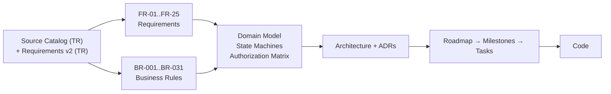

# Student Monitor — Documentation Vault

Coaching platform for Turkish exam preparation (YKS / LGS), used alongside regular school by
**coaches (koç)**, **students (öğrenci)** and **parents (veli)**.

> [!info] How to read this vault
> The client's source documents are in Turkish and live untouched: the original
> [[Source - Requirement Catalog (TR)]] and, since October 2026, [[Source - Requirements v2 (TR)]],
> [[Source - Decision Log (TR)]] and [[Source - Backend Plan (TR)]] — see
> [[Requirements v2 Delta]] for what v2 changed. Everything else is written in English, with
> [[Glossary]] mapping every domain term TR ↔ EN ↔ code identifier.

## Start here

- [[Kasa Haritası (TR)]] — **where everything lives**: note-by-note and heading-by-heading map of
  this vault, in Turkish. Read it first if you do not know your way around yet
- [[Vault Guide]] — conventions, IDs, statuses, how to add a note
- [[Product Vision]] — what this is and who it is for
- [[Requirements v2 Delta]] — **what the October 2026 requirement update changed**
- [[Scope and MVP]] — what we build first, what we defer
- [[Open Questions]] — decisions the client still owes us
- [[Requirements Index]] — all 25 functional areas
- [[Business Rules Index]] — the 31 hard rules (İK-001..İK-031)
- [[Gereksinimler (TR)]] — **all 25 requirements and 31 rules on one page, in Turkish**. The
  companion to [[Kasa Haritası (TR)]]: use it to talk the spec through with the client

## Map



## Sections

| Folder | Contents |
| --- | --- |
| `00-Meta` | [[Vault Guide]], [[Glossary]], note templates |
| `01-Product` | vision, personas, scope, open questions, the original Turkish catalog |
| `02-Requirements` | FR notes per functional area + business rules |
| `03-Domain` | [[Domain Model]], [[Entity Map]], [[State Machines]], [[Authorization Matrix]], [[Pricing and Earnings]], [[Progress and Filiz]] |
| `04-Architecture` | [[Architecture Overview]], [[Tech Stack]], [[Frontend Architecture]], [[Data Model]], [[API Conventions]], [[Security and Privacy]], ADRs |
| `05-Delivery` | [[Roadmap]], [[Milestones]], [[Task Board]], task notes |
| `06-Design` | [[UX Principles]], [[Screen Inventory]] |
| `99-Archive` | superseded notes, kept for history |

## Current state

- [x] Requirements captured from the client catalog and given IDs
- [x] Domain model and authorization matrix drafted
- [x] October 2026 requirement update (v2) integrated → [[Requirements v2 Delta]]
- [ ] Roadmap/milestones reconciled with the v2 scope and build order
- [ ] Architecture conflicts from the v2 technical plan resolved → [[Open Questions|Q-26]]
      (platform half **done** 2026-10-20 → [[ADR-0017]]; auth and hosting still open)
- [ ] Open questions answered by the client → [[Open Questions]]
- [ ] Repo scaffolded (M0) → [[Roadmap]]
- [ ] First vertical slice: auth + coach–student link (M1)

```dataview
TABLE status, priority, source
FROM "02-Requirements"
WHERE id != null AND status != null
SORT id ASC
```
